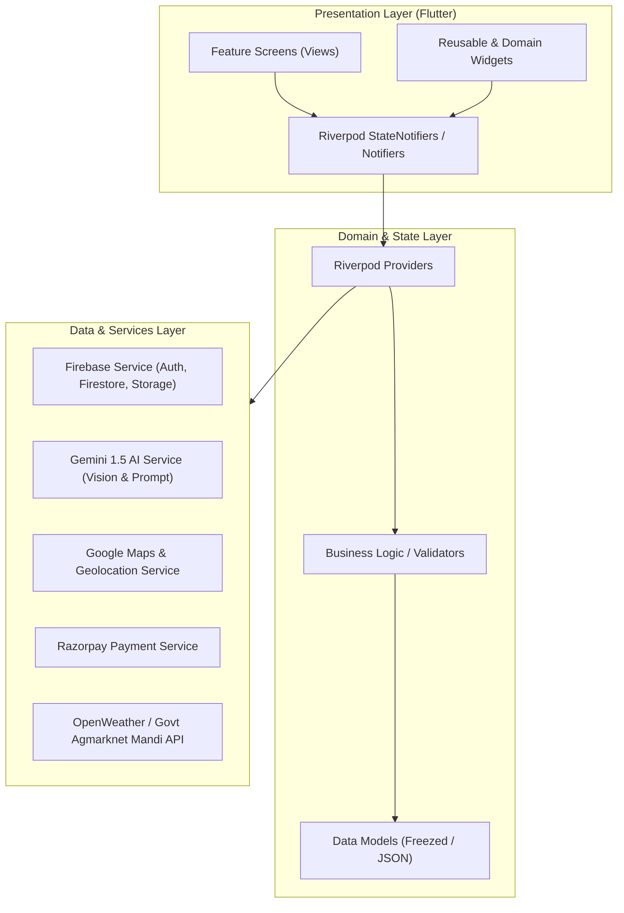

# AGRI AI — System Architecture & Design Specification

## 1. Architectural Philosophy: Feature-First Clean Architecture

AGRI AI follows a **Feature-Driven Clean Architecture** combined with **Riverpod** for compile-time safe, testable state management. This separation ensures that the codebase remains modular, clean, and easily maintainable by a developer or team.



---

## 2. Directory Structure Breakdown

```text
ai_crop_disease_detection_system/
├── android/                        # Android native configurations, Gradle, permissions
├── assets/
│   ├── icons/                      # Custom app icons (crop doctor, mandi, cart, voice)
│   ├── images/                     # Onboarding illustrations, banners, default avatars
│   └── mock_data/                  # JSON mocks for offline testing
├── lib/
│   ├── main.dart                   # Entry point: initializes Firebase, crashlytics, runs runApp
│   ├── app.dart                    # App root widget, theme injection, routing configuration
│   ├── core/
│   │   ├── constants/
│   │   │   ├── app_colors.dart     # Agricultural Green (#2E7D32), Earth White, etc.
│   │   │   ├── app_text_styles.dart# Readable typography for outdoor/farmer visibility
│   │   │   ├── app_dimensions.dart # Card radiuses, paddings, icon sizes
│   │   │   └── api_endpoints.dart  # Mandi, Weather, and Backend endpoints
│   │   ├── errors/
│   │   │   ├── exceptions.dart     # Custom exception classes
│   │   │   └── failures.dart       # User-facing error messages
│   │   ├── network/
│   │   │   └── api_client.dart     # HTTP client wrapper with retry & timeout
│   │   ├── theme/
│   │   │   ├── app_theme.dart      # Light & Dark ThemeData (Material 3)
│   │   │   └── color_schemes.dart  # Color palettes
│   │   └── widgets/
│   │   │   ├── custom_button.dart  # Rounded elevated button with loading state
│   │   │   ├── custom_text_field.dart # High-contrast input field
│   │   │   ├── loading_indicator.dart # Brand loading spinner
│   │   │   └── error_card.dart     # User-friendly error card with retry button
│   ├── features/
│   │   ├── splash_onboarding/
│   │   │   ├── presentation/screens/ # SplashScreen, OnboardingScreen
│   │   │   └── presentation/widgets/ # OnboardingPageItem, IndicatorDots
│   │   ├── auth/
│   │   │   ├── data/                 # AuthRepository, FirebaseDataSource
│   │   │   ├── domain/               # UserModel, UserRole (farmer, customer, delivery)
│   │   │   ├── presentation/screens/ # LoginScreen, RegisterScreen, RoleSelectionScreen
│   │   │   └── state/                # auth_controller.dart, auth_state.dart
│   │   ├── crop_doctor/
│   │   │   ├── data/                 # GeminiAIService, DiagnosisHistoryRepository
│   │   │   ├── domain/               # CropDiagnosisResult, HealthScore, Treatment
│   │   │   ├── presentation/screens/ # CameraScanScreen, DiagnosisResultScreen, HistoryScreen
│   │   │   └── state/                # crop_doctor_controller.dart
│   │   ├── smart_farming/
│   │   │   ├── data/                 # WeatherService, AdvisoryService
│   │   │   ├── domain/               # WeatherForecast, CropRecommendation
│   │   │   ├── presentation/screens/ # SmartFarmingDashboardScreen
│   │   │   └── state/                # weather_controller.dart
│   │   ├── mandi_prices/
│   │   │   ├── data/                 # MandiPriceService, LocationService
│   │   │   ├── domain/               # MandiItem, PriceTrend
│   │   │   ├── presentation/screens/ # MandiMarketScreen, PriceComparisonScreen
│   │   │   └── state/                # mandi_controller.dart
│   │   ├── marketplace/
│   │   │   ├── data/                 # ProductRepository, CartRepository
│   │   │   ├── domain/               # ProductModel, CartItem, OrderModel
│   │   │   ├── presentation/screens/ # FarmerAddProductScreen, CustomerCatalogScreen, CartScreen
│   │   │   └── state/                # marketplace_controller.dart, cart_controller.dart
│   │   ├── orders_delivery/
│   │   │   ├── data/                 # DeliveryRepository, OrderTrackingService
│   │   │   ├── domain/               # DeliveryTask, OTPVerificationModel
│   │   │   ├── presentation/screens/ # OrderTrackingScreen, DeliveryPartnerDashboardScreen
│   │   │   └── state/                # delivery_controller.dart
│   │   └── voice_assistant/
│   │       ├── data/                 # BhashiniService / SpeechToTextService
│   │       ├── domain/               # VoiceQuery, AudioResponse
│   │       ├── presentation/screens/ # AgriMitraSheet, VoiceAssistantModal
│   │       └── state/                # voice_assistant_controller.dart
│   └── navigation/
│       ├── app_router.dart           # Declarative navigation (GoRouter or Navigator 2.0)
│       └── bottom_navigation_bar.dart# Dynamic bottom bar based on active user role
```

---

## 3. Security Guidelines & Secrets Management

1. **Zero Secret Hardcoding**:
   - Neither Gemini API keys, Firebase service accounts, nor Razorpay secrets will ever be hardcoded into frontend Dart files.
   - We will use `.env` files with `flutter_dotenv` combined with `.gitignore`.
2. **Backend Delegation**:
   - Razorpay Order ID generation and payment signature verification must take place via a secure backend endpoint (or Firebase Cloud Function / FastAPI).
3. **Firestore Security Rules**:
   - Farmers can only edit or delete their own product listings.
   - Customers can only read products and read/write their own orders.
   - Delivery partners can only update orders assigned to their UID.

